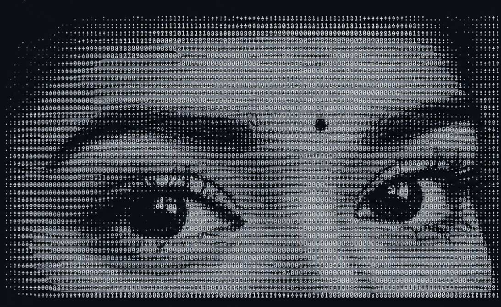

 

 

# 👋 Hi, I'm Ranjith N

### 🎓 4th Year Engineering Student | Aspiring Software Developer

---

## 👨‍💻 About Me

Hello! I'm Ranjith N, a fourth-year engineering student passionate about technology, programming, and software development.

- 🎓 Currently pursuing my 4th year of engineering.
- 💻 Interested in Web Development and Software Development.
- 🌱 Continuously learning new technologies.
- 🐍 Exploring Python programming.
- 🗄️ Learning database management using SQL.
- 🎨 Interested in creating clean and responsive web interfaces.
- 🚀 Focused on improving my technical and problem-solving skills.

---

## 🛠️ Tech Stack & Skills

### Languages & Technologies

| Technology | Area of Interest |
|:---|:---|
| HTML5 | Web Structure |
| CSS3 | Styling & Responsive Design |
| Python | Programming & Logic Building |
| SQL | Database Management |

---

## 📊 GitHub Statistics

 

---

## 🌐 Connect With Me

---

### 💡 "Dream. Code. Create. Repeat."

**Thanks for visiting my GitHub profile!** ⭐

